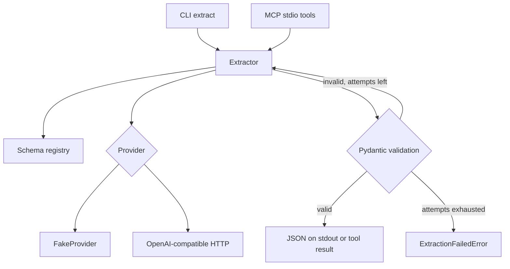

# structured-extract

[](https://github.com/AlonsoAlviraa/structured-extract-mcp/actions/workflows/ci.yml)

Extract a typed record from unstructured text, check it against a Pydantic model, and try again with the validation error if it does not match.

Source: https://github.com/AlonsoAlviraa/structured-extract-mcp

This repository is a small public example of two things: a provider interface around structured LLM output, and a minimal [MCP](https://modelcontextprotocol.io) server. It is meant to be read in one sitting.

Author: Alonso Alvira Ballano. License: MIT.

## What it does

You give it a schema name and a piece of text (an invoice email, a job posting, a support ticket). It asks a provider for JSON, validates that JSON with Pydantic, and returns the model. If validation fails, it sends the error back to the provider and tries again, up to a fixed number of attempts. If the attempts run out, it raises. It does not fill in an empty object and call that success.

The default provider is offline. It does not call a model and it does not need an API key. A second provider speaks the OpenAI chat-completions API, so the same client can point at OpenAI, NVIDIA NIM, Ollama, or another compatible server.

## 60-second quickstart

Requires Python 3.11+ and [uv](https://docs.astral.sh/uv/). Commands assume the repository root.

```bash
uv sync
uv run extract --list-schemas
uv run extract --schema invoice examples/invoice.txt
uv run extract --schema job_posting examples/job_posting.txt
uv run extract --schema support_ticket examples/support_ticket.txt
```

`--list-schemas` prints:

```text
invoice
job_posting
support_ticket
```

`extract --schema invoice examples/invoice.txt` prints the validated object. Logs go to stderr. The default level is warning, so a successful run writes only JSON to stdout. Excerpt (the file has three line items):

```json
{
  "vendor": "Northwind Supply Co.",
  "invoice_number": "INV-2026-1042",
  "issued_on": "2026-03-12",
  "currency": "USD",
  "total": "182.52",
  "payment_terms": "Net 30"
}
```

Money is a decimal string (`"182.52"`), not a JSON number.

The same command with `examples/job_posting.txt` as if it were an invoice exits `1` and prints the reason. The offline provider does not guess missing fields.

Without uv:

```bash
python -m venv .venv
source .venv/bin/activate
pip install -e .
extract --schema invoice examples/invoice.txt
```

## Using a real model

The offline provider stays selected until you opt in. A missing key does not fall back to it.

```bash
export STRUCTURED_EXTRACT_PROVIDER=openai
export OPENAI_API_KEY=sk-...
export OPENAI_MODEL=gpt-4o-mini
# Optional. Include the /v1 prefix your server expects.
export OPENAI_BASE_URL=https://api.openai.com/v1
uv run extract --schema invoice examples/invoice.txt
```

| Variable | Default | Meaning |
| --- | --- | --- |
| `STRUCTURED_EXTRACT_PROVIDER` | `fake` | `fake` or `openai` |
| `OPENAI_BASE_URL` | `https://api.openai.com/v1` | Base URL. The client posts to `{base_url}/chat/completions` |
| `OPENAI_API_KEY` | unset | Required when the provider is `openai`. Servers that ignore the key still need a non-empty value |
| `OPENAI_MODEL` | `gpt-4o-mini` | Model name sent in the request |
| `STRUCTURED_EXTRACT_RESPONSE_FORMAT` | `json_schema` | `json_schema`, `json_object`, or `none` |
| `STRUCTURED_EXTRACT_TIMEOUT` | `30` | Seconds for one request |
| `STRUCTURED_EXTRACT_MAX_ATTEMPTS` | `3` | Validation attempts, including the first |
| `STRUCTURED_EXTRACT_LOG_LEVEL` | `WARNING` on the MCP server | Standard library level. The CLI uses warning, or debug with `--verbose` |

`json_schema` sends the Pydantic schema as OpenAI strict structured output (`response_format.type = json_schema`, `strict: true`). Some local servers only accept `{"type": "json_object"}` or reject `response_format` entirely. Set `STRUCTURED_EXTRACT_RESPONSE_FORMAT` to match the server. The client does not downgrade on its own: if the server returns an error, that error is raised.

Ollama's OpenAI-compatible endpoint is typically:

```bash
export STRUCTURED_EXTRACT_PROVIDER=openai
export OPENAI_BASE_URL=http://127.0.0.1:11434/v1
export OPENAI_API_KEY=ollama
export OPENAI_MODEL=llama3.1
export STRUCTURED_EXTRACT_RESPONSE_FORMAT=json_object
```

## CLI

```text
extract --schema invoice examples/invoice.txt
extract --schema invoice -          # stdin
extract --list-schemas
extract --provider openai --timeout 20 --max-attempts 2 --schema invoice note.txt
extract --verbose --schema invoice examples/invoice.txt
```

Exit codes: `0` validated JSON on stdout, `2` bad arguments or configuration (unknown schema, missing file, missing API key), `1` the provider failed or validation never passed.

## MCP server

The server uses the official `mcp` Python SDK (`MCPServer` in mcp 2.x) and stdio. It exposes two tools:

- `list_schemas` — schema names
- `extract(schema, text)` — validated JSON text, or a tool error

Stdout is the protocol. The process logs to stderr.

```bash
uv run structured-extract-mcp
```

That process waits for an MCP client. Cursor (`~/.cursor/mcp.json`) and Claude Desktop (`claude_desktop_config.json`) can start it:

```json
{
  "mcpServers": {
    "structured-extract": {
      "command": "uv",
      "args": ["--directory", "/absolute/path/to/this/repo", "run", "structured-extract-mcp"],
      "env": {
        "STRUCTURED_EXTRACT_PROVIDER": "fake"
      }
    }
  }
}
```

Point the same block at a model by setting `STRUCTURED_EXTRACT_PROVIDER` to `openai` and adding `OPENAI_API_KEY`, `OPENAI_BASE_URL`, and `OPENAI_MODEL`. Paths must be absolute. `uv --directory` is there so the server can be started from another working directory.

## Architecture



A provider returns text. The extractor is the only place that decides whether that text is a successful record. Timeouts and HTTP errors skip the retry loop: there is no new validation error to show the model, and repeating the same request would spend the timeout again.

## Design decisions

**One method on the provider.** `complete(messages, schema_name, json_schema, timeout) -> str`. The OpenAI client, the offline parser, and the test double (`ScriptedProvider`) all implement it. Tests never open a socket.

**Retries are only for validation.** Invalid JSON, extra fields, a string where an integer is required, a money value of `"182.5"`, a salary range that is upside down: those go back to the model as `Validation error:` plus the Pydantic messages, with the bad reply as the previous assistant turn. The cap is `max_attempts` (default 3).

**Strict models.** `extra="forbid"` and `strict=True`, so `"10"` is not accepted as the integer `10`. The JSON schema sent upstream also sets `additionalProperties: false` and marks every property required, which is what OpenAI strict mode asks for.

**Money is text.** Invoice amounts are strings with two fractional digits. JSON numbers are binary floats. The models do not check that line items sum to the total.

**The fake provider is a parser for the files in `examples/`.** Those files are emails with labels (`Vendor:`, `Line items:`, and so on). If a label is missing it raises `UnrecognizedInputError`. It is not used when the OpenAI provider fails.

**httpx, not the OpenAI SDK.** The request is a small JSON body. Any server that implements `POST /chat/completions` can sit behind `OPENAI_BASE_URL`. The API key is stripped from HTTP error text if the server echoes it.

**One fence is stripped.** If the whole reply is a markdown JSON fence, the fence is removed before validation. Surrounding prose is not scraped for a JSON object. If the inner text is still invalid, the attempt counts as a failure.

**Logs.** Info logs record the schema, the attempt, and the length of the input. They do not record the input. Validation failures are warnings. The CLI stays quiet unless something fails or you pass `--verbose`.

## Layout

```text
src/structured_extract/
  cli.py            argparse entry point
  config.py         environment variables
  exceptions.py     typed errors
  extractor.py      validation and retry
  mcp_server.py     stdio MCP server
  providers.py      fake, scripted, and HTTP providers
  schemas.py        invoice, job posting, support ticket
examples/           sample emails the fake provider can parse
tests/              pytest, no network
.github/workflows/ci.yml
```

Public import surface: `extract`, `get_schema`, `available_schemas`, and the exception types.

## Development

```bash
uv sync --extra dev
uv run ruff check .
uv run pytest
```

CI runs those two commands on Python 3.11 and 3.12.

## Limitations

- The offline provider only understands the labeled layout in `examples/`. Other text fails. That is intentional.
- HTTP 429, HTTP 5xx, connection errors, and timeouts are not retried.
- There is no check that line-item totals add up to the invoice total.
- The strict JSON schema helper covers these models. It is not a general converter for every keyword OpenAI strict mode rejects (`allOf`, numeric constraints on some servers, and so on).
- `temperature` is always `0`. A server that rejects that field needs a code change.
- The MCP server is stdio only. There is no authentication and no container image.
- Nothing here has been measured against a model benchmark. The tests check the retry loop, the HTTP request shape, and the offline parser.
